# HDDS Demos

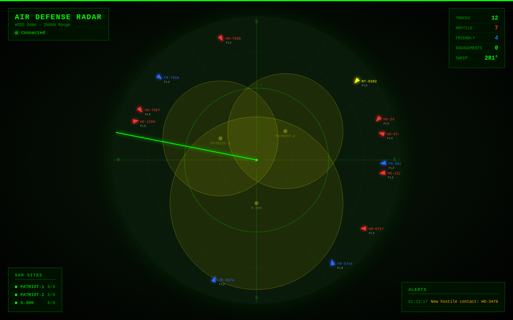

24 self-contained demonstrations of **[HDDS](https://github.com/hdds-team/hdds)**,
a high-performance DDS implementation in pure Rust. Each one is a real
distributed system rather than a mock-up: a Rust simulator publishes on DDS
topics, a separate viewer subscribes to them, and nothing is shared between
the two but the wire.

Radar tracks, train signals, satellite passes, robot swarms, racing cars,
factory floors: pick the one closest to your problem and read how it is
wired. Every screenshot on this page was taken from the demo actually
running, by `tools/capture-screenshots.sh`.

All demos use DDS domain 99.

## Quick Start

```bash
# Prerequisites
# - Rust toolchain (rustup.rs)
# - Node.js 18+ (for web viewers)
# - hddsgen, only to regenerate types after editing an IDL file: the
#   generated Rust is committed, so a clone builds without it
#
# Three demos build a desktop window and need system libraries, which is
# what `make build` fails on first if they are missing:
# - GTK4 development files: fort-knox-security, rpc-service-mesh
# - FLTK development files: hot-reload-cockpit
# - an X11 or Wayland development stack for egui: fort-knox-security,
#   nat-wan-topology

# 1. Build all demos
make build

# 2. Run any demo (example: air-defense-radar)
cd air-defense-radar
cargo run --release -p radar-sim

# 3. For web viewers, start the bridge and the viewer AFTER the simulator
hdds-ws --domain 99 --port 9090
cd air-defense-radar/radar-viewer && npm install && npm run dev
```

The order of the last two steps matters. The bridge resolves a topic's type
from the endpoints present when it creates its reader, which happens when the
browser subscribes: if nothing is publishing at that moment, the first samples
reach the browser as opaque bytes until the type is discovered. Starting the
simulator first avoids that blind window.

## Gallery

<table>
<tr>
<td align="center" width="33%"><a href="air-defense-radar/"></a><br><a href="air-defense-radar/">air-defense-radar</a></td>
<td align="center" width="33%"><a href="arcade-shooter/">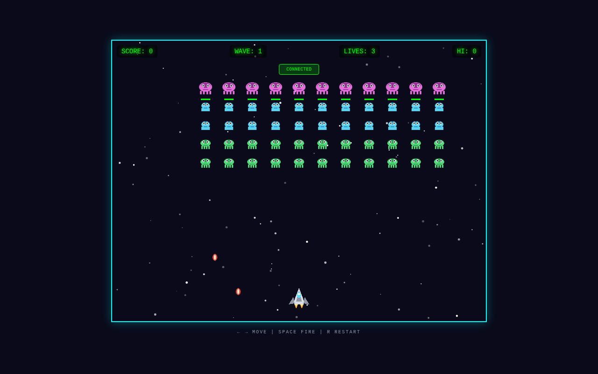</a><br><a href="arcade-shooter/">arcade-shooter</a></td>
<td align="center" width="33%"><a href="artillery-fire-control/">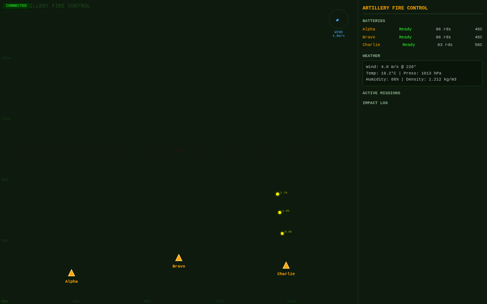</a><br><a href="artillery-fire-control/">artillery-fire-control</a></td>
</tr>
<tr>
<td align="center"><a href="convoy-escort/">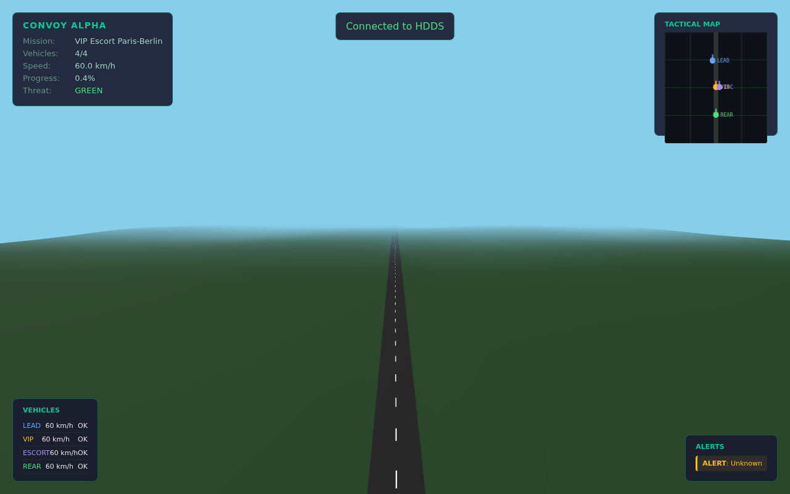</a><br><a href="convoy-escort/">convoy-escort</a></td>
<td align="center"><a href="drone-racing/">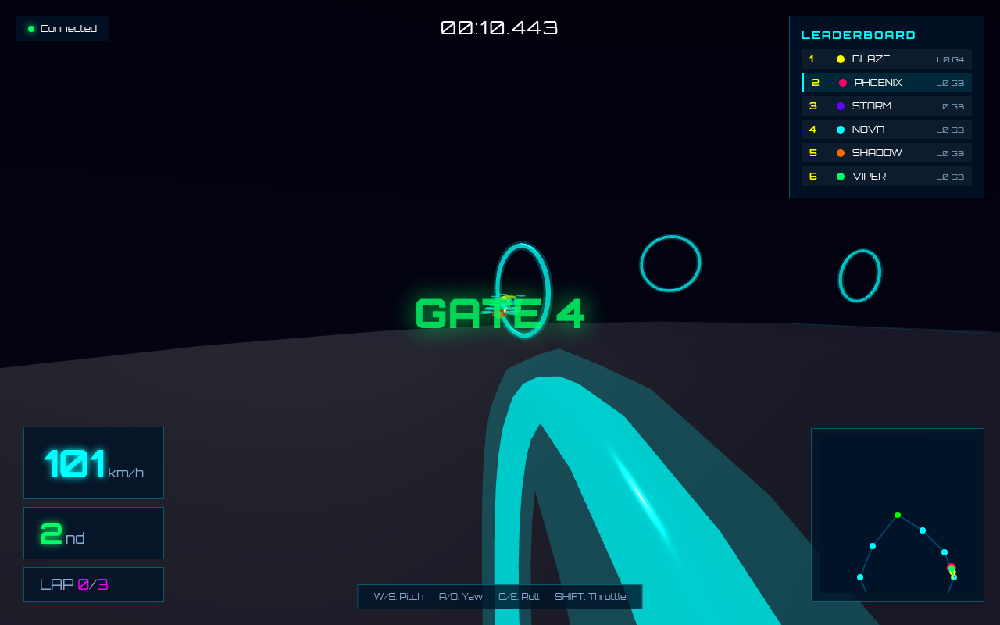</a><br><a href="drone-racing/">drone-racing</a></td>
<td align="center"><a href="f1tenth-racing/">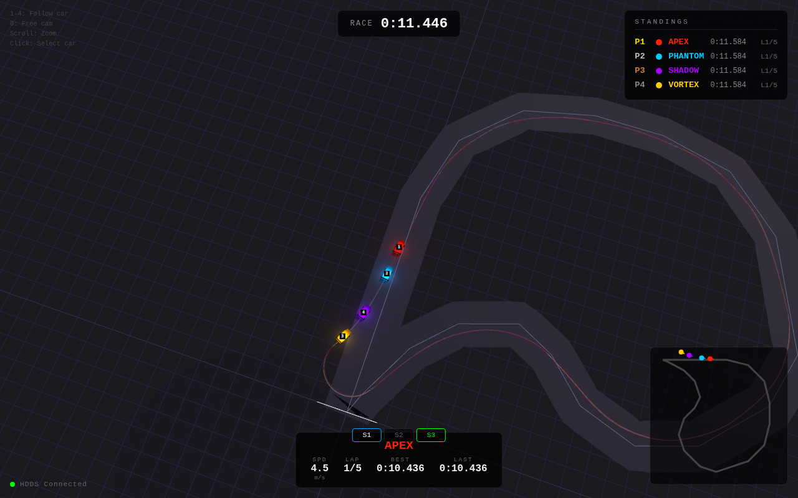</a><br><a href="f1tenth-racing/">f1tenth-racing</a></td>
</tr>
<tr>
<td align="center"><a href="lidar-mapping/">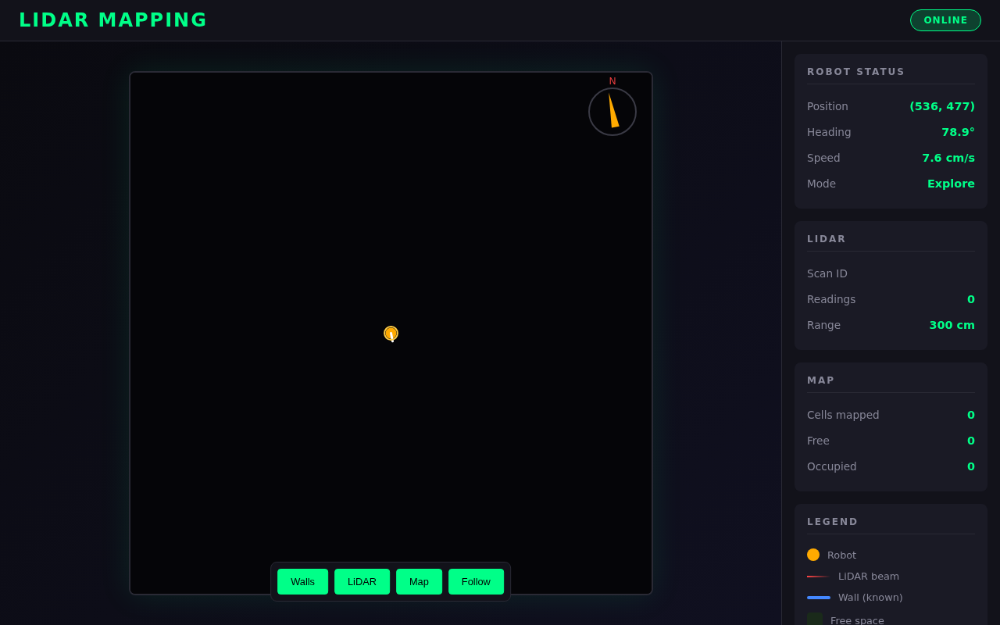</a><br><a href="lidar-mapping/">lidar-mapping</a></td>
<td align="center"><a href="naval-convoy/">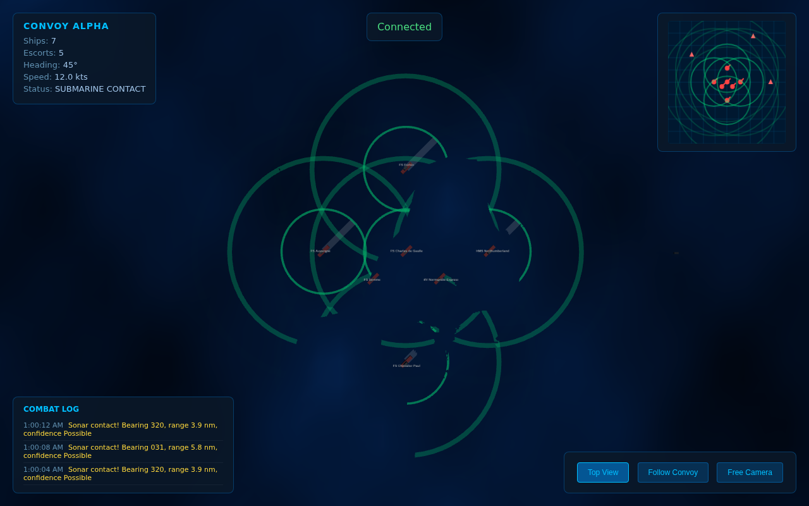</a><br><a href="naval-convoy/">naval-convoy</a></td>
<td align="center"><a href="predictive-maintenance/">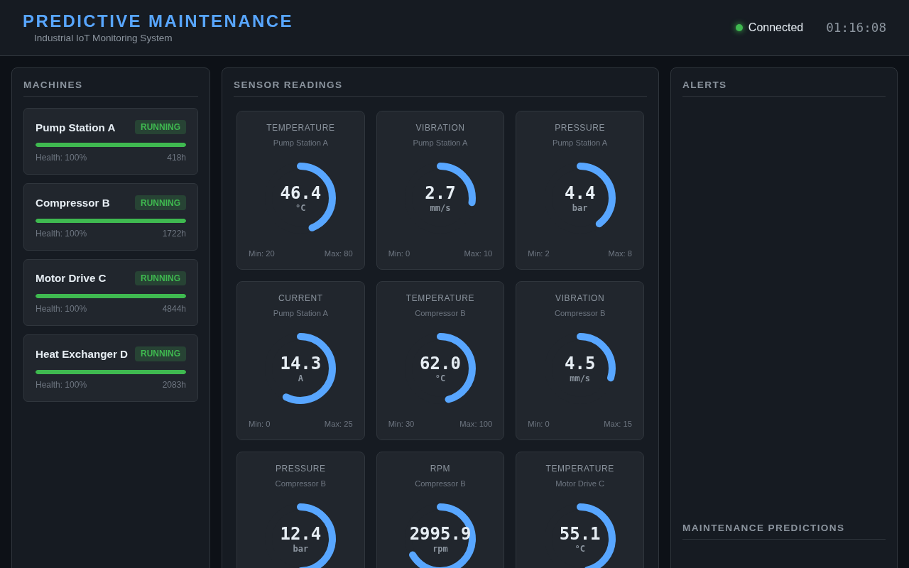</a><br><a href="predictive-maintenance/">predictive-maintenance</a></td>
</tr>
<tr>
<td align="center"><a href="railway-network/">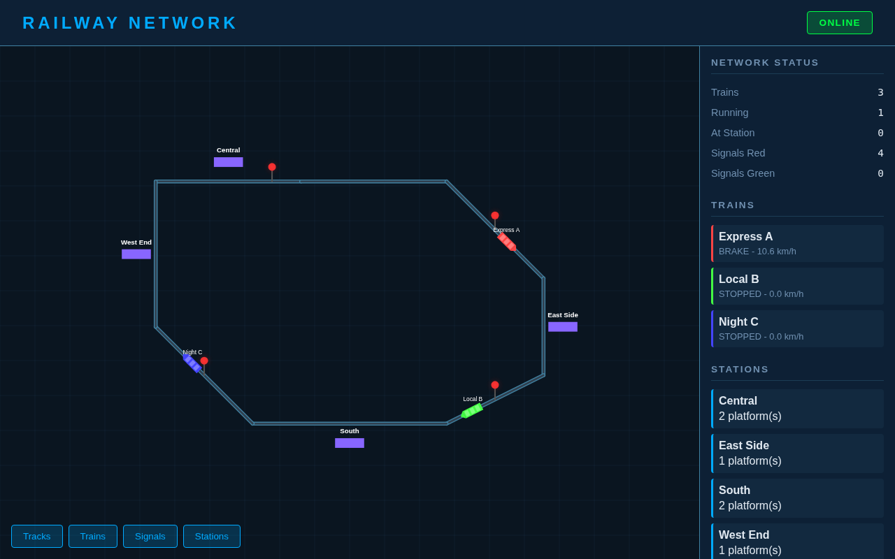</a><br><a href="railway-network/">railway-network</a></td>
<td align="center"><a href="robot-swarm/">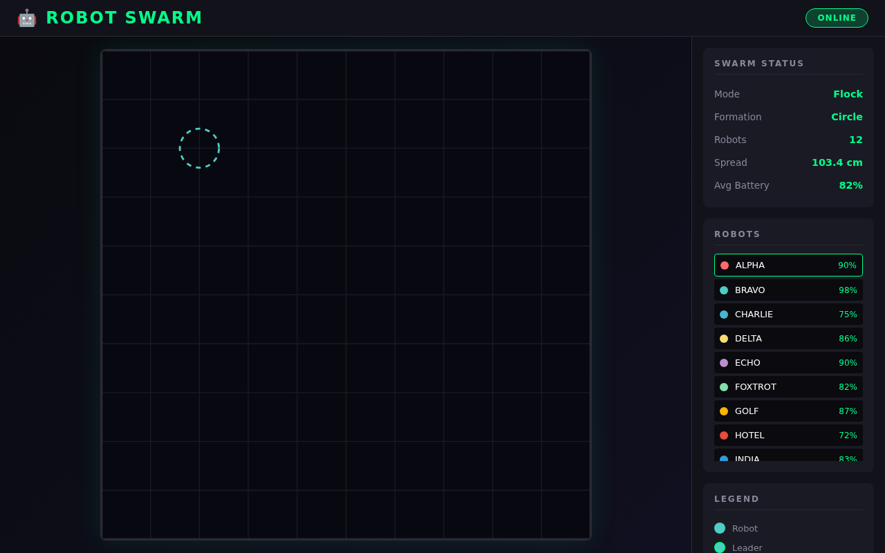</a><br><a href="robot-swarm/">robot-swarm</a></td>
<td align="center"><a href="run-and-gun-arena/">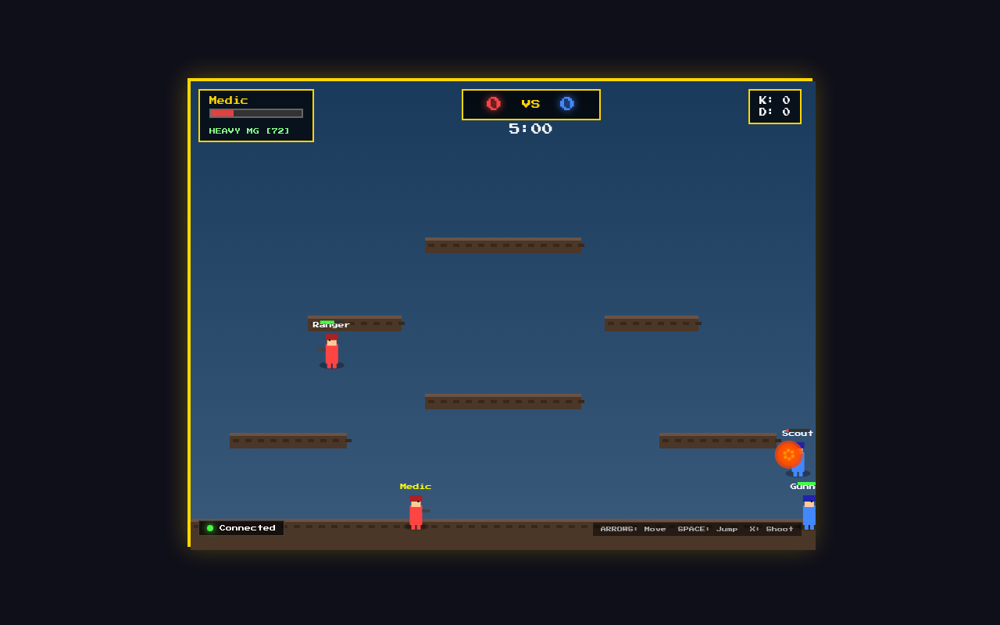</a><br><a href="run-and-gun-arena/">run-and-gun-arena</a></td>
</tr>
<tr>
<td align="center"><a href="satellite-ground-station/">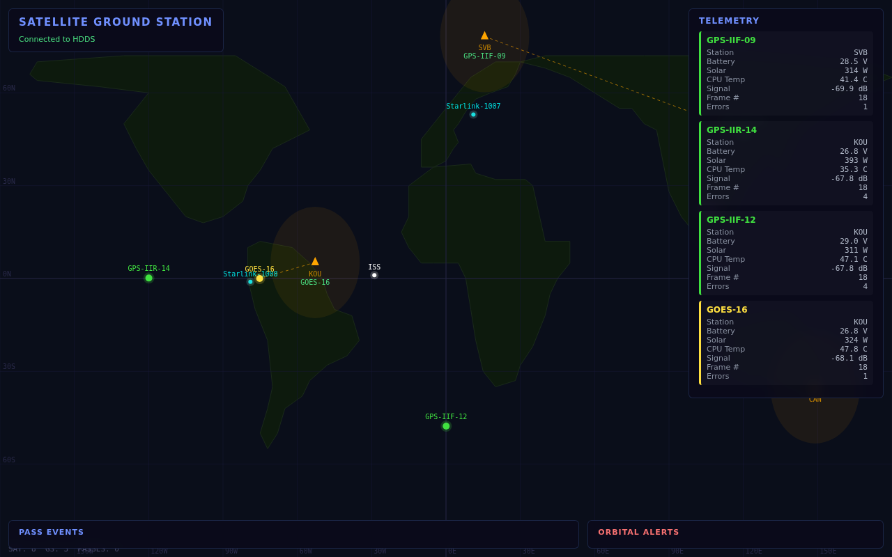</a><br><a href="satellite-ground-station/">satellite-ground-station</a></td>
<td align="center"><a href="smart-factory/">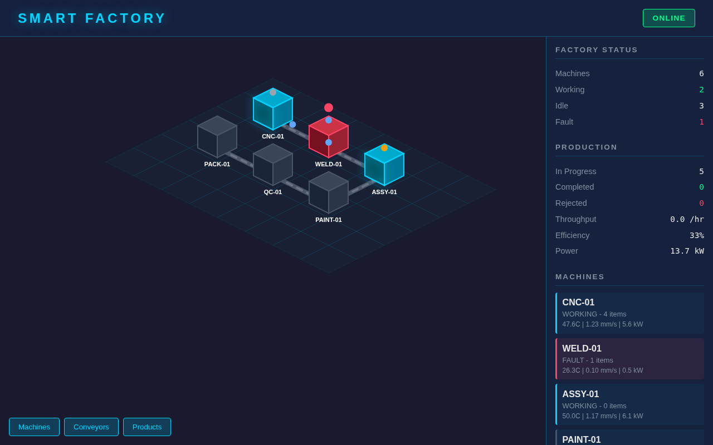</a><br><a href="smart-factory/">smart-factory</a></td>
<td></td>
</tr>
</table>

The ten remaining demos render in a terminal or a desktop window and are not
photographed here: `cloud-k8s`, `fort-knox-security`, `hdds-remote-sensor`,
`hot-reload-cockpit`, `mission-recorder`, `nat-wan-topology`,
`rpc-service-mesh`, `tsn-automotive`, `uds-fleet-diag`, `xrce-micro-bridge`.

## All demos

| Demo | Description | Viewer |
|------|-------------|--------|
| [air-defense-radar](air-defense-radar/) | Real-time radar tracking with threat classification and engagement zones | Web (Canvas) |
| [arcade-shooter](arcade-shooter/) | Wave shooter where every game event is a DDS topic | Web (Canvas) |
| [artillery-fire-control](artillery-fire-control/) | Fire mission coordination with ballistic trajectory computation | Web (Canvas) |
| [cloud-k8s](cloud-k8s/) | Kubernetes pod metrics streaming via DDS, no polling and no Prometheus | Console (TUI) |
| [convoy-escort](convoy-escort/) | VIP convoy protection with real-time GPS and tactical alerts | Web (Three.js) |
| [drone-racing](drone-racing/) | 6 autonomous drones racing through gates at 60 Hz | Web (Three.js) |
| [f1tenth-racing](f1tenth-racing/) | Bicycle-physics autonomous cars with adaptive AI driving | Web (Three.js) |
| [fort-knox-security](fort-knox-security/) | DDS security dashboard: permissions, certs, audit logs in real time | Desktop (egui + GTK4) |
| [hdds-remote-sensor](hdds-remote-sensor/) | ESP32 + Raspberry Pi decentralized sensor over HC-12 radio | Web |
| [hot-reload-cockpit](hot-reload-cockpit/) | Live QoS policy tuning with sliders, no restarts | Desktop (FLTK) |
| [lidar-mapping](lidar-mapping/) | Robot SLAM: autonomous maze exploration and occupancy grid mapping | Web (Canvas) |
| [mission-recorder](mission-recorder/) | Record, replay and analyze all DDS traffic from a session | Console (TUI) |
| [nat-wan-topology](nat-wan-topology/) | DDS connectivity through NAT and firewalls with ICE | Desktop (egui) |
| [naval-convoy](naval-convoy/) | Merchant ships escorted against submarines: sonar, torpedoes, depth charges | Web (Three.js) |
| [predictive-maintenance](predictive-maintenance/) | Industrial equipment degradation detection with anomaly scoring | Web (Canvas) |
| [railway-network](railway-network/) | Independent train processes coordinated by DDS signaling | Web (Canvas) |
| [robot-swarm](robot-swarm/) | 12 robots with boids, formations, and emergent behavior patterns | Web (Canvas) |
| [rpc-service-mesh](rpc-service-mesh/) | DDS-RPC service discovery, health checks, and live invocation browser | GTK4 |
| [run-and-gun-arena](run-and-gun-arena/) | 2D platformer deathmatch synchronized via DDS pub/sub | Web (Canvas) |
| [satellite-ground-station](satellite-ground-station/) | 8 satellites in LEO, MEO and GEO + 3 ground stations with orbital tracking | Web (Canvas) |
| [smart-factory](smart-factory/) | Industry 4.0: AGVs, conveyors, and production lines without central control | Web (Canvas) |
| [tsn-automotive](tsn-automotive/) | Multi-priority ECU communication with TSN deterministic networking | Console (TUI) |
| [uds-fleet-diag](uds-fleet-diag/) | Fleet-wide ISO 14229 diagnostics: ECU health, firmware, AI alerts | Console |
| [xrce-micro-bridge](xrce-micro-bridge/) | DDS-XRCE agent bridging resource-constrained micro-clients | Console (TUI) |

## Build Info

Each demo compiles independently. Full build of all 24 demos:

- **Source**: 7.0 MB over 350 tracked files, of which 1.4 MB is the screenshot
  gallery, generated Rust types included
- **Binaries**: 36 packages carry a `main.rs`
- **Build artifacts**: large. Six demos built in release, sharing one target
  directory, already take 2.2 GB
- **node_modules**: each web viewer installs its own, with `npm install`
- **Build time**: depends on cache state; first full build is significant

Individual demo binaries are typically 4-5 MB each (release mode).

> **Note**: Build artifacts (`target/`) are not included in the repository.
> Run `make gen` before `make build` to generate types from IDL definitions.

## Architecture Pattern

Most demos follow the same pattern:

```
demo-name/
  idl/              IDL type definitions (input for hdds_gen)
  *-types/          Generated Rust types + CDR codecs (make gen)
  *-sim/ or *-server/   Rust DDS publisher (cargo run --release)
  *-viewer/         Web viewer: Vite + JS/TS (npm run dev)
```

```
+-----------+     DDS/RTPS      +----------+    WebSocket     +------------+
|  *-sim    | ----------------> | hdds-ws  | ---------------> |  *-viewer  |
|  (Rust)   |   UDP Multicast   | (bridge) |   JSON proto     |  (Browser) |
+-----------+                   +----------+                  +------------+
```

Entities are published as keyed instances, one sample each, rewritten as they
change. A viewer keeps the latest sample per key and drops the keys that stop
being refreshed; no list of entities ever travels on the wire.

## Makefile Targets

| Target | Description |
|--------|-------------|
| `make gen` | Regenerate all Rust types from IDL via hddsgen |
| `make build` | Build all 24 demos (reports OK/FAIL count) |
| `make gen-build` | Regenerate + build |
| `make clean` | Remove all `target/` directories |

## Tools

| Script | What it does |
|--------|--------------|
| `tools/capture-screenshots.sh` | Refreshes `docs/screenshots/` by running each demo and photographing its viewer once it has received samples |
| `arcade-shooter/tools/generate-sprites.py` | Draws the shooter sprite set from geometry, standard library only |
| `convoy-escort/tools/generate-vehicle-model.py` | Builds the escort vehicle mesh from boxes and prisms |

## Dependencies

- **Rust** toolchain (stable)
- **HDDS** - included via workspace path dependencies
- **hddsgen** - IDL code generator (from hdds_gen repo)
- **hdds-ws** - WebSocket bridge (from hdds repo, `tools/hdds-ws`)
- **Node.js 18+** - for web viewers
- **GTK4** - for rpc-service-mesh fleet-explorer only
- **PlatformIO** - for hdds-remote-sensor ESP32 firmware only

## License

Licensed under either of [Apache-2.0](LICENSE-APACHE) or
[MIT](LICENSE-MIT), at your option.
